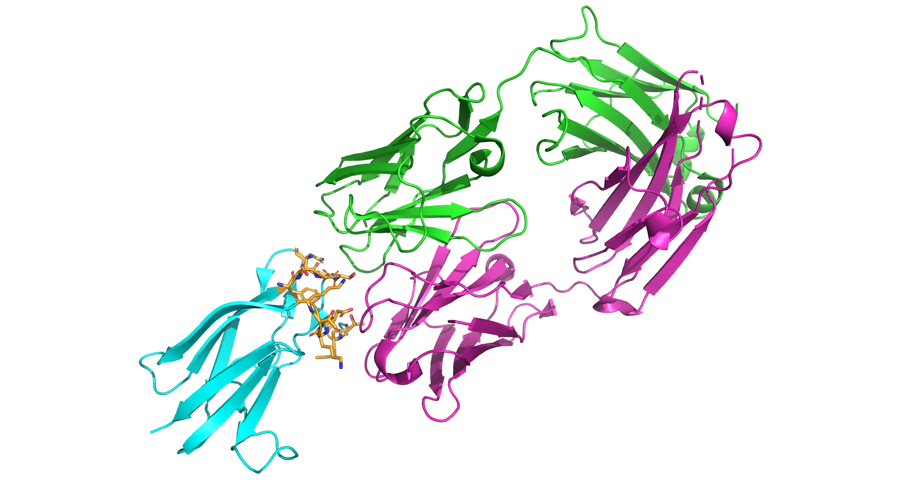
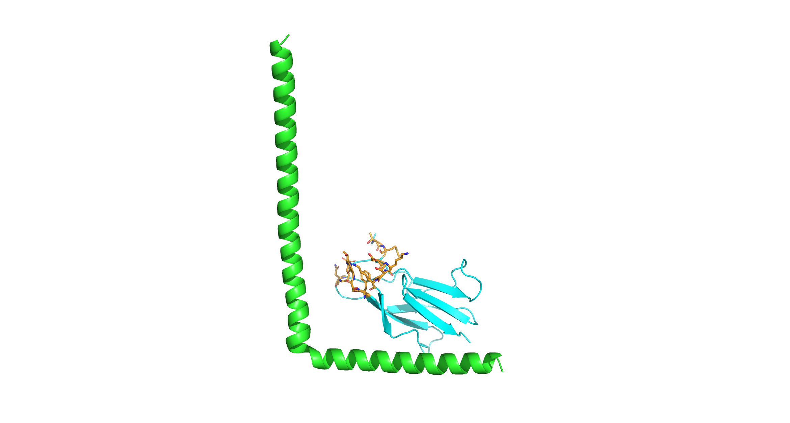
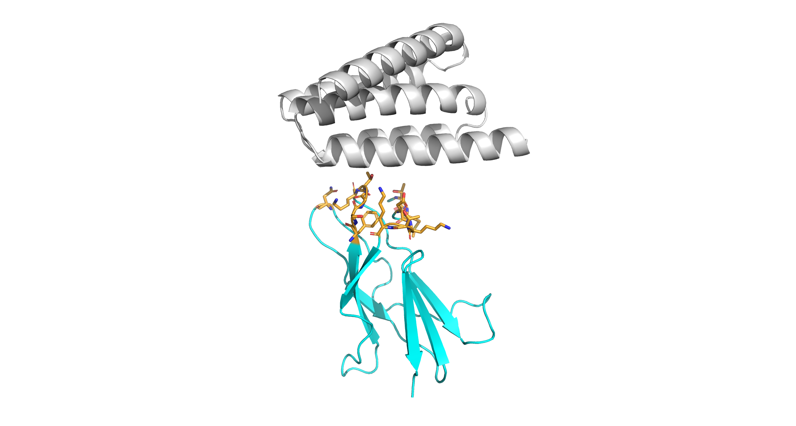
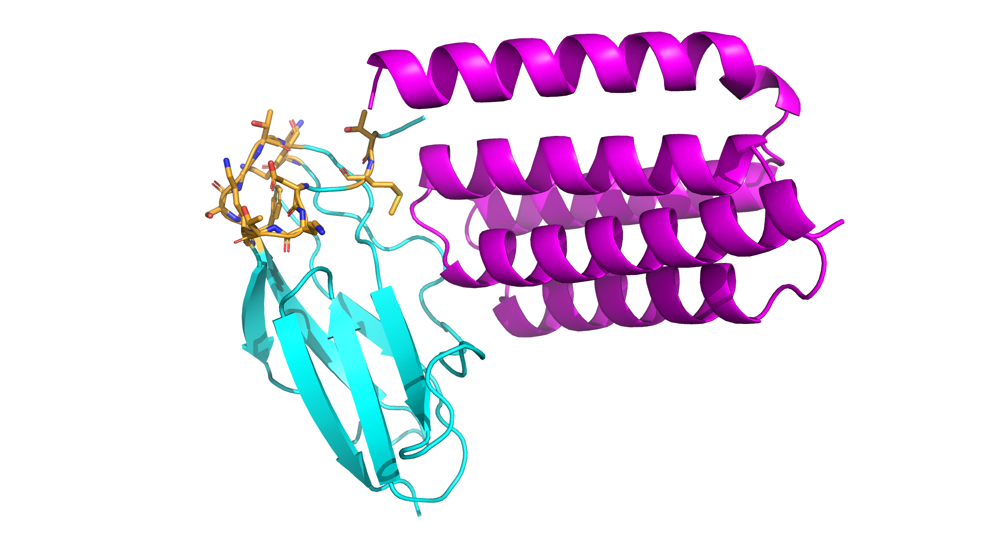

# RosettaBootcamp

Code for ML & Rosetta Intro Bootcamp 2026 at Johns Hopkins University

## Flavivirus Envelope Protein Binder Project

As a final capstone to the bootcamp, we broke into groups to design de novo protein binders. My group (including myself, Adaym Corbet and Dr. Amanda E. Ruiz) chose to target the [EDIII](https://www.rcsb.org/structure/7LSE) envelope protein of tick-borne encephalitis virues (TBEV), particularly the region bound by a human neutralizing antibody. The protein plays an important role in viral attachment and internalization, and Amanda is studying it as a potential antiviral target.

__Image 1. Project binding target.__ EDIII (cyan). Residues targeted for binding (orange). Bound neutralizing antibody domains (green, magenta).

We first generated 40 potential binding backbones using RFdiffusion. The quality of potential backbones varied wildly from stringy Ls to compact alpha helical bundles.

__Image 2. "Big L" generated backbone.__ EDIII (cyan). Residues targeted for binding (orange). Generated stringy backbone (green).

__Image 3. Compact binder candidate.__ EDIII (cyan). Residues targeted for binding (orange). Compact alpha helical bundle (white).

We curated a handful of plausible alpha helical bundles, generated potential sequences for these candidates using LigandMPNN, and then refolded the sequences using Alphafold. Alphafold recreated many of the bundles with high confidence. However, it did not recreate the associated binding between target and binder.

__Image 4. Alphafold does not recreate binding.__ EDIII (cyan). Residues targeted for binding (orange). Compact binder from Image 3 (magenta). Note that Alphafold recreated each protein domain but not the association between domains.

In order to further test the (in)effectiveness of our binders, we used the Rosetta scoring function to calculate an energy for both the bound and unbound conditions. The results showed a higher energy for the associated complexes than the disassociated individual proteins, further confirming that while our binders were likely to fold, they were unlikely to actually bind our target.

| Target Only Energy | Binder Only Energy | Total Disassociated Energy | Complex Energy |
|:--:|:--:|:--:|:--:|
| -170 | -227 | -397 | -370 |

__Table 1. Rosetta calculated binding energies for the binder in Image 4.__

Overall, our brief (single day) attempt to design a binder for EDIII was unsuccesful. Nonetheless, the project was useful practice for understanding de novo protein.
